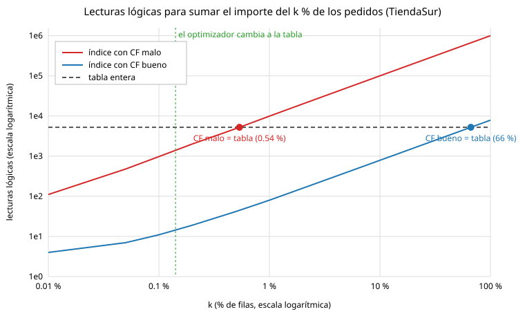

# Lab 5 · Respuestas

Las evidencias están en `docs/bitacora/lab5/evidencia/` (`script/`, `spool/` y `config/`). Las cito por número y nombre.

Una cosa del entorno que conviene saber para leer las cifras: el 2 de noviembre, entre la Parte B y la C, Windows se reinició con el contenedor en marcha. El contenedor quedó en `Exited (255)` y, al arrancarlo, Oracle hizo sola una recuperación de instancia (`Beginning crash recovery of 1 threads`, 0,31 MB de redo aplicados, `healthy` en 20 s). Fue un simulacro A sin planificar: no se perdió nada confirmado.

## Preguntas de comprobación

### Punto de partida y banco de medida (A, B)

**1. Compara el paso 6 de tu copia lab4-final con el de la copia lab3-final. ¿Qué demuestra la diferencia?**

En mi caso no hay diferencia en el paso 6: las dos copias dicen "ninguno: el volumen contiene toda la base de datos" (`script/..._00-backup-lab4` y, en el Lab 4, `script/..._00-backup-lab3`; el manifiesto de lab3-final pone `archivos_fuera_del_volumen=0`). Lo que cambia es dónde están los archivos: en el inventario de lab3-final los TBS_* salen como `/opt/oracle/product/26ai/dbhomeFree/dbs/academia01.dbf` y en el de lab4-final como `/opt/oracle/oradata/FREE/FREEPDB1/academia01.dbf`. En esta imagen `$ORACLE_HOME/dbs` es un enlace simbólico al volumen, así que ya estaban dentro, pero en una carpeta rara. La copia demuestra que la reubicación del Lab 4 funcionó: ahora están en su carpeta estándar y no dependen de ese enlace.

**2. Calcula el bfr de CLIENTE y de PEDIDO con sus estadísticas. ¿Por qué PEDIDO cabe casi el triple de filas por bloque?**

CLIENTE: 100 000 filas / 1517 bloques = 66 filas por bloque. PEDIDO: 1 000 000 / 5320 = 188 (`script/..._01-perfil-tiendasur`). Caben casi el triple porque las filas de PEDIDO miden 32 bytes de media y las de CLIENTE 102, unas 3,2 veces más: con el mismo bloque de 8 KB y el mismo PCTFREE, el bfr va al revés que el tamaño de fila. En el reto conté las filas reales con DBMS_ROWID: 5220 bloques con filas, entre 2 y 200 por bloque, media 191,6. La media real es mayor que 188 porque BLOCKS cuenta 100 bloques bajo la HWM sin filas, y no todos tienen lo mismo porque las filas no miden igual (un NUMBER ocupa más bytes cuanto más grande es) y el último bloque está casi vacío.

**3. ¿Por qué el banco de medida ejecuta cada sentencia dos veces y mide solo la segunda?**

Porque la primera ejecución arrastra trabajo que no es de la consulta: el análisis duro, las consultas recursivas al diccionario, leer bloques del disco que todavía no están en la caché y la limpieza diferida de bloques. Si se midiera esa, comparar dos alternativas sería comparar quién tuvo más suerte con la caché. La segunda mide el coste estable, en caliente.

### Anatomía y tipos de índice (C, D)

**4. Con tu evidencia 02: altura, número de hojas y fan-out real de IX_PED_CLIENTE. ¿Qué altura tendría con mil millones de filas?**

Altura 3, 2216 hojas y 6 bloques de rama. El fan-out real es (2216 + 6 - 1) / 6 = 370; el máximo, 8028 / 14,8 = 543 entradas por rama (`script/..._02-anatomia-indice`). Con mil millones de filas tendría unas 2 208 969 hojas y altura 4, es decir, 5 lecturas para encontrar una fila. La altura crece con el logaritmo: de un millón a mil millones de filas, un nivel más.

**5. En el volcado de la hoja de PK_CLIENTE, localiza una entrada y descompón el ROWID que guarda en bloque y fila. ¿Por qué no aparece el número de archivo?**

La primera entrada de la hoja es `row#0 ... len=11, data:(6): 00 00 03 1b 00 00` con la clave `c1 02`, que es el número 1. Los 6 bytes son 4 de bloque (`00 00 03 1b` = 0x31b = 795) y 2 de fila (`00 00` = 0), y la comprobación con DBMS_ROWID da para el cliente 1 el bloque 795 y la ranura 0 (`config/..._02-volcado-indice.trc.txt`). No aparece el archivo porque TBS_TIENDASUR es BIGFILE: tiene un solo archivo, así que basta con el número de bloque, y el objeto tampoco hace falta porque el índice es de una sola tabla. Por eso la entrada mide 11 bytes y no 13 o más.

**6. Elige tres pruebas de la Parte D y explica, con las lecturas lógicas medidas, por qué un tipo de índice gana al otro.**

- Q13 (DNI): sin índice, 1486 lecturas (la tabla entera); con UNIQUE, 3 (raíz, hoja y bloque de tabla). Además ahora la base impide el duplicado (ORA-00001).
- Q7 (historial del cliente): con IX_PED_CLIENTE, 15 lecturas y un SORT; con el compuesto (id_cliente, fecha), 7 y sin ordenar porque el índice ya devuelve las filas en orden; con el cubriente, 3, porque ni siquiera va a la tabla.
- Q14 (almacén de datos): sin índices, 4073 lecturas; con cuatro bitmaps combinados con BITMAP AND, 528. Y el bitmap de región ocupa 114 hojas frente a 1954 del B-tree equivalente. Gana porque son columnas de pocos valores y la tabla solo se carga de noche.

(`script/..._03-tipos-indice`)

### Agrupamiento, equilibrio y sargabilidad (E, F)

**7. ¿Por qué IX_PED_FECHA tiene un CF cercano al número de bloques e IX_PED_CLIENTE cercano al de filas? ¿Lo arreglaría un REBUILD?**

Los pedidos se cargaron con `INSERT /*+ APPEND */ ... ORDER BY n` y la fecha va en el mismo orden que la carga: pedidos de fechas vecinas quedaron en bloques vecinos, y recorrer IX_PED_FECHA en orden cambia de bloque solo 5220 veces (5320 bloques). El cliente, en cambio, se repartió al azar, y recorrer IX_PED_CLIENTE salta de bloque casi en cada entrada: 999 041 para 1 000 000 de filas. Calculado a mano sale lo mismo que en DBA_INDEXES (`script/..._04-agrupamiento-equilibrio`). Un REBUILD no lo arregla, porque el CF depende de cómo están ordenadas las filas de la tabla y no del índice. Habría que reordenar la tabla por cliente, y entonces sería la fecha la que quedaría desordenada.

**8. Según tu curva de la Parte E, ¿a partir de qué porcentaje deja de compensar cada índice? Compáralo con la fórmula de la Unidad 3.**

El de CF malo cruza la línea de la tabla entera (5232 lecturas) en torno al 0,54 % de las filas, y la fórmula en lecturas lógicas da k/r < 1/188 = 0,53 %: casi igual. El de CF bueno no la cruza hasta cerca del 66 %, porque lee unos k/bfr bloques y no uno por fila. El optimizador cambia al recorrido completo entre el 0,1 % y el 0,2 % (lo marqué en el 0,14 %), que se parece a la fórmula con coste de disco (c_sec/c_aleat = 1/5) de 0,11 %: el optimizador razona en tiempo y no en lecturas lógicas, y la lectura multibloque le sale más barata por bloque. La gráfica está en el reto de la Parte E.

**9. Explica por qué Q4b ('Gonz%') usa el índice y aun así lee más bloques que un recorrido completo.**

'Gonz%' es un rango en el índice, así que es sargable y el optimizador puede usarlo. Pero devuelve 2056 clientes, un 2,1 % de la tabla, por encima del punto de equilibrio de CLIENTE (1/66, un 1,5 %), y esos clientes están desperdigados por la tabla: casi cada fila es un bloque distinto. Por eso hace 2024 lecturas frente a las 1523 del recorrido completo de Q4a (`script/..._05-sargabilidad`). El optimizador lo elige porque estima en tiempo y cuenta con que muchos de esos bloques estarán en la caché, pero en lecturas lógicas pierde.

### Coste de escritura y mantenimiento (G, H)

**10. Con tu evidencia 06: bloques modificados por INSERT con 4, 9 y 5 índices. ¿Qué índices de la propuesta del compañero rechazaste y con qué dato?**

Por fila insertada: con 4 índices, 10,2 bloques y 1341 bytes de redo; con los 9 del compañero, 20,2 bloques y 2552 bytes; con los 5 de V005, 12,1 bloques y 1611 bytes (`script/..._06-indices`). Rechacé IX_PED_CANAL (3 valores, cada uno el 33 % de la tabla: no viable y nadie lo usó en MONITORING USAGE), IX_PED_ESTADO (4 valores, 25 % de media; para 'P' es mejor el índice parcial IX_PED_PENDIENTES, de 54 hojas frente a 2933) e IX_PED_FEC_CLI (no lo usó ninguna consulta y su prefijo repite IX_PED_FECHA). También salió IX_PED_IMPORTE: invisible, Q2 siguió con 323 lecturas, y no lo usaba nadie. IX_PED_CLIENTE se fue porque su columna es el prefijo del compuesto (id_cliente, fecha), que además sigue sirviendo a la clave ajena.

**11. Distingue, con tus gráficos de la Parte H, un índice con divisiones 50/50, uno con divisiones 90/10 y uno con patrón cola.**

IX_AZAR (claves al azar) hizo 595 divisiones, todas 50/50: el histograma va del 40 % al 99 %, la media es del 75,4 % y el mapa alterna `=` y `-`. IX_CRECIENTE hizo 398 divisiones, todas 90/10: 398 de sus 399 hojas están al 90-99 % y el mapa es todo `#`. IX_COLA tiene 219 hojas vacías: el mapa está en blanco a la izquierda, donde se borró, y lleno (`#`) a la derecha, donde se inserta, y "dame el siguiente mensaje" lee 221 bloques en vez de 2 (`script/..._07a-*` y `_07b-*`).

**12. ¿Qué remedio elegirías para el patrón cola en producción, en horario de servicio, y por qué?**

COALESCE: es en línea, no bloquea y fusiona las hojas medio vacías dentro del índice. En mi medida pasó de 420 hojas a 201 y la búsqueda del siguiente mensaje de 221 lecturas a 2 (`script/..._07c-remedios`). SHRINK SPACE además devuelve el espacio (1,69 MB) y también va en línea, pero hace más trabajo; REBUILD ONLINE necesita el doble de espacio y mucho redo, y no hace falta. La cura de verdad es de diseño: particionar por fecha y vaciar particiones enteras.

### SCN, control files, redo y FRA (I a L)

**13. Con tu evidencia 08: ¿qué valores compara Oracle al abrir para decidir si hace falta recuperación?**

El SCN de checkpoint que guarda el control file para cada datafile (`v$datafile.checkpoint_change#`) con el que está escrito en la cabecera de ese datafile (`v$datafile_header`). En mi evidencia los dos valían 4199013 ("sincronizado") y, tras el CHECKPOINT, 4206877. Si una cabecera estuviera por detrás, ese archivo necesitaría recuperación de medios (ORA-01113). Para la recuperación de instancia mira además si la base se cerró limpia: tras un SHUTDOWN ABORT aplica el redo desde la posición del último checkpoint.

**14. ¿Qué protege la multiplexación del control file en el mismo volumen y qué no? ¿Cómo se haría en producción?**

Protege del borrado o la corrupción de una de las copias: en el simulacro B borré `control03.ctl`, el arranque se paró con ORA-00205 y bastó con copiar `control01.ctl` encima (9 s). No protege de perder el volumen o el disco, porque las tres copias están en el mismo. En producción cada copia va en un disco y una controladora distintos (en ASM, una en +DATA y otra en +FRA, por ejemplo); en Docker sería montar volúmenes distintos sobre almacenamiento distinto.

**15. Explica los estados CURRENT, ACTIVE e INACTIVE con tu evidencia 10 y por qué Oracle rechaza los tres borrados del paso 4.**

CURRENT es el grupo en el que escribe LGWR ahora (al principio, el 3 con la secuencia 12). ACTIVE es un grupo que ya no se escribe, pero cuyo contenido aún hace falta para una recuperación de instancia porque el checkpoint no ha terminado (tras el cambio, el 3 con la secuencia 12 pasó a ACTIVE). INACTIVE es un grupo que ya no hace falta (secuencias 10 y 11). Oracle rechaza borrar el grupo CURRENT (ORA-01623), un miembro del grupo CURRENT (ORA-01609) y un grupo que todavía no se ha archivado (ORA-00350), porque cada una de esas operaciones perdería redo necesario para recuperar o para archivar (`script/..._10-redo`).

**16. Describe la cadena de causas del escenario de la FRA llena, desde ORA-19815 hasta que la base deja de aceptar cambios.**

Con la FRA reducida a 2 MB, el espacio se agota y el alert log avisa con `ORA-19815: WARNING: db_recovery_file_dest_size of 2097152 bytes is 100.00% used`. ARCn intenta archivar el grupo lleno, no puede crear el archivo (`ORA-19809: limit exceeded for recovery files`) y el archivado falla (`ORA-16038: log 1 sequence# 16 cannot be archived`). Ese grupo queda con ARCHIVED = NO y no se puede reutilizar. En cuanto LGWR da la vuelta y necesita ese grupo, se queda esperando ("log file switch (archiving needed)") y con él toda sesión que genere redo, es decir, cualquier cambio; las conexiones nuevas reciben ORA-00257. En mi evidencia se veía el grupo 1 (secuencia 16) sin archivar y el 2 en CURRENT. Al devolver los 4 GB, ARCn reintentó solo y archivó las secuencias 16 y 17 (`script/..._11-fra-llena`).

### Undo, WAL y simulacros (M a P)

**17. Explica, con los pasos 1 a 4 de tu evidencia 12, la frase "lectores no bloquean a escritores".**

A hizo un UPDATE de la fila 101 a EGRESADO sin confirmar y tenía un bloqueo TM en modo 3 sobre la tabla y un TX en modo 6 sobre la fila. Mientras tanto B leyó la fila sin esperar y vio ACTIVO, el valor confirmado, reconstruido con el undo de A (1 bloque y 1 registro de undo en `v$transaction`). Ni la lectura de B esperó a A ni A tuvo que esperar a B. Solo cuando B quiso bloquear la fila con `FOR UPDATE WAIT 3` chocó con A: ORA-00054 (`script/..._12-lectura-consistente`).

**18. ¿Por qué un DELETE genera más undo que un INSERT? ¿Por qué el ROLLBACK también genera redo?**

Para deshacer un INSERT basta con apuntar "borra este ROWID"; para deshacer un DELETE hay que guardar la fila entera y sus entradas de índice. Con 10 000 pedidos: INSERT, 141 bloques de undo (1128 KB); DELETE, 427 (3416 KB). El ROLLBACK genera redo porque deshacer es volver a modificar bloques de datos e índices, y todo cambio en un bloque se protege con redo: el ROLLBACK del DELETE generó 4701 KB (`script/..._12-undo-y-redo`).

**19. Con tu evidencia 13: ¿dónde está la garantía de durabilidad justo después del COMMIT? ¿Y después del checkpoint?**

Justo después del COMMIT está en el redo log en línea: el UPDATE de 20 000 filas y su COMMIT generaron 7006 KB de redo en 6 escrituras de LGWR, DBWn no había escrito ningún bloque y en la caché quedaban 231 bloques sucios de la tabla. Si la instancia cayera ahí, el roll forward rehace esos cambios desde el redo. Después del CHECKPOINT, DBWn escribió 555 bloques, la tabla quedó con 0 sucios y los cambios ya están en los datafiles, así que el redo antiguo deja de ser necesario para una recuperación de instancia (`script/..._13-lgwr-dbwn`).

**20. Simulacro A: explica roll forward y roll back con las filas 102 y 103 y las líneas del alert log.**

Antes del SHUTDOWN ABORT confirmé 102 → EGRESADO y dejé sin confirmar 103 → INACTIVO. Al arrancar, el alert log muestra `Beginning crash recovery of 1 threads`, `Recovery starting at checkpoint rba (logseq 20 block 14904), scn 4213094`, `read 21 KB redo, 22 data blocks need recovery` y `Completed redo application of 0.01MB`. Ese es el roll forward: rehace todo lo que estaba en el redo desde el último checkpoint, el cambio confirmado de 102, el no confirmado de 103 y el undo de ambos. Después viene el roll back: con el undo se deshace lo que no tenía COMMIT. Resultado: 102 EGRESADO y 103 ACTIVO, sin que yo hiciera nada más que un STARTUP (`script/..._14a-caida-instancia`).

**21. Simulacros C y D: tu RTO y tu RPO en cada uno. ¿Por qué son tan distintos?**

C (DROP ... PURGE y restauración de la copia en frío completa): RTO 86 s y RPO "todo lo hecho desde la copia", 2 s aquí porque la hice justo antes, pero en la vida real sería todo lo ocurrido desde la última copia en frío. D (datafile perdido con RMAN): RTO 13 s y RPO 0, porque la fila 104, cambiada después de la copia, seguía EGRESADO. Son distintos porque en C se restaura el volumen entero y no se aplica redo, mientras que en D se restaura un solo archivo y RECOVER aplica el redo archivado y el redo en línea posteriores a la copia. Eso solo es posible con ARCHIVELOG y copias RMAN.

**22. Clasifica cada error ORA- del bloque 5 de tu runbook: incidente real, efecto del laboratorio o ruido conocido.**

- `ORA-01113 file 26 needs media recovery` (dos veces), `ORA-01110 data file 16` y `ORA-63999 data file suffered media failure`: efecto del laboratorio, el simulacro D. ORA-63999 lo lanzó CKPT al encontrarse el archivo borrado y cerró la PDB; los ORA-01113 son de cuando la reabrí y Oracle revisó las cabeceras de sus archivos (el 26 es `tiendasur01.dbf`). Después no quedó ningún archivo en `v$recover_file`.
- `ORA-00202 control file: control03.ctl` y `ORA-205 signalled during: ALTER DATABASE MOUNT`: efecto del laboratorio, el simulacro B.
- `ORA-00800 [Set Priority Failed] [VKTM]` y `[LGWR]`: ruido conocido del contenedor, sale en cada arranque.
- Incidente real: ninguno en ese bloque. El único incidente real del día fue el reinicio de Windows, que no deja ORA- sino una recuperación de instancia.

(`spool/..._15-healthcheck`)

## Game day: tabla de RTO y RPO

| Simulacro | Qué se rompió | RTO medido | RPO real | Qué me sorprendió | Qué cambiaría |
|-----------|---------------|------------|----------|-------------------|---------------|
| A | Caída de la instancia (SHUTDOWN ABORT) | ~10 s (ABORT 18:23:03,9; OPEN 18:23:14,0) | 0 | Que solo hubiera que leer 21 KB de redo y 22 bloques: el checkpoint reciente deja muy poco por rehacer | Nada del procedimiento, pero en serio no usaría ABORT como costumbre. El reinicio de Windows del mismo día fue este caso sin avisar y salió igual de bien |
| B | Una copia del control file | 9 s (todo el script) | 0 | El mensaje ORA-00205 no dice qué archivo; hay que ir al alert log (ORA-00202 con la ruta) | Tener las copias en volúmenes distintos y apuntar en el runbook que el primer paso es mirar el alert log |
| C | Tabla borrada con PURGE | 86 s (restauración completa) | Todo desde la copia (2 s aquí; en real, desde la última copia en frío) | Que sin PURGE la papelera lo arregla en un segundo con FLASHBACK TABLE, y con PURGE hay que tirar de la base entera | Para un DROP de una tabla usaría RMAN RECOVER TABLE, que no hace retroceder el resto de la base |
| D | Datafile de TBS_ACADEMIA | 13 s | 0 | Que Oracle cerrara FREEPDB1 entera (ORA-63999): el fallo de un archivo dejó sin servicio a toda la PDB | Lanzar el RESTORE solo con la PDB ya MOUNTED (el script ya espera) y tener siempre una copia RMAN reciente: sin ella no hay camino rápido |

Preguntas del punto de control del simulacro D: me tocó el camino B (la PDB estaba MOUNTED antes de reparar). Lo provocó CKPT: el alert log tiene `ORA-63999: data file suffered media failure` en `FREE_ckpt_95.trc` justo después del FLUSH BUFFER_CACHE, al no poder abrir el archivo 16. La fila 104 sale EGRESADO aunque la copia es anterior al cambio porque RECOVER aplicó el redo archivado (el script hizo SWITCH LOGFILE) y el redo en línea posteriores a la copia. El RTO de C (86 s) es más de seis veces el de D (13 s), y el RPO de D es 0 frente a "todo desde la copia" en C.

## Retrospectivas

### Incidente: DML colgado por FRA llena (escenario de la Parte L)

- Impacto: con la FRA a 2 MB, `ALTER SYSTEM ARCHIVE LOG CURRENT` falló y el grupo 1 (secuencia 16) se quedó sin archivar. Si se hubiera dado la vuelta a los tres grupos, todo cambio se habría quedado esperando en "log file switch (archiving needed)". Ninguna pérdida de datos.
- Detección: el error de la propia sentencia y el alert log (`ORA-19815 ... 100.00% used`, `ORA-19809`).
- Causa raíz: un límite de FRA (2 MB) más pequeño que lo que había que archivar. En el caso real de la Parte L.3 fue repetir cargas de un millón de filas con ARCHIVELOG y 4 GB de FRA; en el mío, el límite rebajado a propósito.
- Mitigación: devolver el tamaño a 4 GB; ARCn reintentó solo y archivó las secuencias 16 y 17 sin tocar nada más.
- Qué cambia: el runbook avisa cuando la FRA pasa del 85 % (reto de la Parte P) y antes de una carga grande se mira `v$recovery_area_usage`. A medio plazo, copias RMAN con política de retención para que los archivados ya copiados se puedan borrar solos.
- Lección: ORA-19815 llega antes que el bloqueo; si alguien mira el aviso, no hay incidente.

### Incidente real: reinicio de Windows con la base abierta (2 de noviembre, 19:02 hora local)

- Impacto: la base estuvo caída mientras el equipo arrancaba y hasta que arranqué Docker Desktop. Ninguna pérdida de datos.
- Detección: el siguiente script falló con "The command 'docker' could not be found" y `docker ps -a` mostraba el contenedor en `Exited (255)`.
- Causa raíz: el contenedor no tiene política de reinicio y Docker Desktop no arranca solo con Windows, así que un reinicio del equipo equivale a un SHUTDOWN ABORT y además deja la base parada.
- Mitigación: arrancar Docker Desktop y `docker start oralab-26ai`; Oracle hizo la recuperación de instancia (0,31 MB de redo) y quedó `healthy` en 20 s.
- Qué cambia: o `--restart unless-stopped` en el 05, o una comprobación al empezar cada sesión (`esperar-healthy.sh`). También hay que volver a lanzar ORDS, que corre en tmux fuera del contenedor.
- Lección: es justo el simulacro A, y salió igual que en el laboratorio.

## Retos de práctica profesional

**Parte B · bfr de PEDIDO a mano.** Está en la pregunta 2: 5220 bloques con filas, mínimo 2 (el último bloque), media 191,6 y máximo 200, con la mayoría en 192 (2867 bloques) y 191 (2301). NUM_ROWS / BLOCKS da 188 porque cuenta 100 bloques sin filas bajo la HWM.

**Parte C · Calcula antes de medir.** A mano, con 30 bytes por entrada y PCTFREE 10: floor(7996 · 0,9 / 30) = 239 entradas por hoja, 100 000 / 239 = 419 hojas y, con fo 543, una sola raíz basta: altura 2. Medido (`script/..._02-reto-ux-cli-email`): altura 3, 501 hojas, 200 entradas por hoja de 35,9 bytes (el email real es más largo que 30) y 500 entradas de rama de 18,2 bytes repartidas en 3 bloques de rama. El fallo de mi cálculo fue suponer el fo de IX_PED_CLIENTE, cuya clave es un número corto: con claves de texto largas caben menos entradas por rama y hace falta un nivel más. PK_CLIENTE, con las mismas 100 000 entradas, tiene altura 2 y 187 hojas al 99,6 % (mapa `#`), mientras que UX_CLI_EMAIL tiene las hojas al 89,6 % (mapa `=`). Las claves de PK_CLIENTE llegaron en orden creciente durante la carga (90/10, hojas llenas) y UX_CLI_EMAIL se creó después con CREATE INDEX, que deja el 10 % de PCTFREE en cada hoja. Además los emails `clienteN@tiendasur.es` se ordenan como texto (cliente1, cliente10, cliente100...), no en el orden de llegada.

**Parte D · El índice cubriente.** No lo pediría: Q9 cuesta hoy 5 lecturas lógicas (0,2 ms) con IX_PED_FECHA, y un cubriente con todas las columnas ocuparía casi lo mismo que la tabla (42 MB), cuando el de cinco columnas de la sección 8 (IX_PED_CLI_FEC_CUB) ya ocupa 40 MB.

**Parte E · Dibuja tu curva.** La gráfica la genera `scripts/lab5/04-reto-curva.sh` (awk) a partir de la sección 3 de la evidencia 04:



Los tres puntos no coinciden porque miden cosas distintas. El índice con CF malo lee un bloque por fila y deja de compensar al 0,54 %, como dice 1/bfr. El de CF bueno lee k/bfr bloques y aguanta hasta el 66 %. Y el optimizador cambia antes, hacia el 0,14 %, porque decide por tiempo estimado y para él una lectura multibloque de la tabla cuesta menos por bloque que una lectura suelta del índice.

**Parte F · Revisión de código.** El comentario que dejaría en el Pull Request:

> issue (blocking): `WHERE SUBSTR(telefono, 1, 3) = '600' OR UPPER(apellidos) = 'GIL'` rompe dos veces la regla 1 (función sobre la columna) y, por la regla 5, basta con que una rama del OR no pueda usar índice para leer CLIENTE entera. Medido con `lab_tools.medir.consulta`: 1487 lecturas lógicas (22,5 ms) con TABLE ACCESS FULL, y las mismas aunque cree índices en `telefono` y `apellidos`. Propuesta: `WHERE telefono LIKE '600%' OR apellidos = 'Gil'` (los apellidos se guardan con mayúscula inicial, como 'Pérez Castro'). Con los dos índices: 722 lecturas (4,8 ms) con BITMAP OR, y como UNION 986 (3 ms). Devuelve las mismas 981 filas. Pregunta: ¿buscabais el apellido exacto "Gil" o los que empiezan por "Gil"? Ahora mismo no hay ninguno exacto y las 981 filas vienen todas del teléfono.

Los índices de prueba se crean y se borran en `scripts/lab5/05-reto-revision.sql` (evidencia `script/..._05-reto-revision`).

**Parte G · Defiende tu propio índice.** Elegí Q5 de la Actividad 3.2 (identificar a quien llama, `email = :dato OR telefono = :dato`, 10 veces por segundo), que V005 no cubre. La migración está en la rama aparte `feat/5-v006-telefono` (`database/migrations/V006__indice_telefono_cliente.sql`) y las medidas en `scripts/lab5/06-reto-v006.sql` (evidencia `script/..._06-reto-v006`):

1. Necesidad: hoy Q5 hace un recorrido completo, 1486 lecturas lógicas por llamada; a 10 por segundo son unas 14 860 lecturas por segundo solo para esto.
2. Viabilidad: TELEFONO tiene 100 000 valores distintos, un 0,001 % por valor, muy por debajo del punto de equilibrio.
3. Escritura: 1000 altas de cliente pasan de 10,2 a 12,1 bloques modificados por fila y de 1402 a 1635 bytes de redo. Las altas de cliente son pocas al día.
4. Redundancia: ningún índice de CLIENTE empieza por TELEFONO (los que hay son PAIS+CIUDAD, ID, DNI y EMAIL).
5. Ciclo de vida: creado INVISIBLE, Q5 siguió igual (1505 lecturas, FULL); al hacerlo visible bajó a 6 lecturas (0,3 ms) con BITMAP OR de UX_CLI_EMAIL e IX_CLI_TELEFONO. Ocupa 3 MB (294 hojas, altura 2).

Conclusión: compensa. No lo he fusionado porque V006 depende de V004 y V005, que entran con el PR de este laboratorio: el PR de V006 se abre contra main después. Descripción preparada:

> ## Summary
> Adds IX_CLI_TELEFONO so caller lookup (Q5: `email = :dato OR telefono = :dato`, 10/s) stops scanning CLIENTE.
>
> ## Evidence (scripts/lab5/06-reto-v006.sql)
> - Q5: 1486 logical reads (full scan) -> 6 (BITMAP OR of UX_CLI_EMAIL and IX_CLI_TELEFONO)
> - Selectivity: 100 000 distinct phones (0.001 % per value); no existing index starts with TELEFONO
> - Write cost: 10.2 -> 12.1 blocks changed and 1402 -> 1635 bytes of redo per inserted customer
> - Size: 3 MB, 294 leaves, height 2. Tested INVISIBLE first, then VISIBLE
>
> ## Related Issue
> Refs #5

**Parte H · Diagnostica sin ver el script.** Depende del índice degradado que tiene que crear el profesor; cuando lo cree, lo diagnosticaré con `grafico-indice.sh` e INDEX_STATS y dejaré el comentario en el issue.

**Parte I · El MTTR bajo carga** (`script/..._08-reto-mttr`). Antes: ESTIMATED_MTTR 36 s y ACTUAL_REDO_BLKS 631 752. Justo después del UPDATE de 20 000 filas con COMMIT: 36 s y 644 975 bloques, es decir 13 223 bloques de redo más (unos 6,5 MB en bloques de 512 bytes). Diez segundos después: 36 s y 13 721. No hubo cambio de log entre medias (la secuencia 12 empezó a las 18:16:16 y el reto fue a las 18:18); lo que pasa es que `v$instance_recovery` se refresca cada cierto tiempo y las dos primeras fotos aún no recogían el CHECKPOINT que acababa de hacer `08-scn-checkpoint.sql`. El valor ya actualizado, 13 721, es casi exactamente el redo del UPDATE. El MTTR estimado no se movió porque también se recalcula periódicamente y 6,5 MB se rehacen en muy poco. La relación: cuanto más redo hay pendiente desde el último checkpoint, más redo hay que aplicar en una recuperación de instancia y más tarda.

**Parte K · Dimensiona el redo de TiendaSur.** En la hora en que cargué TiendaSur (2026-11-01, 23 h UTC) hubo un solo cambio de log, el de la secuencia 3 a la 4 a las 23:03:46, así que con grupos de 200 MB esa carga ya cumple "como mucho 4 cambios". La hora con más cambios fue la de los experimentos de índices (2026-11-02, 18 h): 9 cambios entre las secuencias 5 y 13, unos 1470 MB de redo. Para dejarla en 4 cambios harían falta grupos de al menos 1470 / 4 ≈ 368 MB, así que propongo 512 MB. Los comandos, sin ejecutar:

```sql
ALTER DATABASE ADD LOGFILE GROUP 4 ('/opt/oracle/oradata/FREE/redo04.log', '/opt/oracle/oradata/FREE/redo04b.log') SIZE 512M;
ALTER DATABASE ADD LOGFILE GROUP 5 ('/opt/oracle/oradata/FREE/redo05.log', '/opt/oracle/oradata/FREE/redo05b.log') SIZE 512M;
ALTER DATABASE ADD LOGFILE GROUP 6 ('/opt/oracle/oradata/FREE/redo06.log', '/opt/oracle/oradata/FREE/redo06b.log') SIZE 512M;
ALTER SYSTEM SWITCH LOGFILE;   -- repetir hasta que el CURRENT sea un grupo nuevo
ALTER SYSTEM CHECKPOINT;       -- para que los grupos 1 a 3 pasen a INACTIVE
-- comprobar en v$log que 1, 2 y 3 están INACTIVE y ARCHIVED = YES
ALTER DATABASE DROP LOGFILE GROUP 1;
ALTER DATABASE DROP LOGFILE GROUP 2;
ALTER DATABASE DROP LOGFILE GROUP 3;
-- y después borrar redo01*.log, redo02*.log y redo03*.log del disco, que Oracle no borra
```

**Parte M · El coste de un DELETE en tu FRA** (`scripts/lab5/12-reto-fra.sh`, evidencia `script/..._12-reto-fra`). Antes de medir archivé el log actual para que el archivado final contuviera solo esta ejecución. La FRA pasó de 28 262 400 a 46 836 736 bytes: creció 18 139 KB, que es justo el tamaño del archivado nuevo (secuencia 19). La columna de redo del script suma 3862 + 340 + 1258 + 751 + 6623 + 4701 = 17 535 KB. La diferencia, unos 600 KB, es redo que el script no cuenta porque mide solo su sesión: el SQL recursivo, lo que hacen a la vez otras sesiones y los procesos de fondo, y el relleno de los bloques de redo de 512 bytes que LGWR escribe a medio llenar.

**Parte O · Runbook del simulacro D.** Está en `docs/runbooks/perdida-datafile.md`.

**Parte P · Un umbral que dispare una alerta** (`scripts/lab5/15-reto-alerta.sql`, evidencia `spool/..._15-reto-alerta`). Para la FRA:

```sql
SELECT 'ALERTA: FRA al ' || ROUND(100 * (space_used - space_reclaimable) / space_limit, 1) || ' %' AS alerta
  FROM v$recovery_file_dest
 WHERE space_limit > 0 AND 100 * (space_used - space_reclaimable) / space_limit > 85;
```

Hoy no devuelve nada (la FRA está al 2,3 %); con el umbral a 0 para probarla devuelve `ALERTA: FRA al 2.3 %`. En el mismo script está la de "ninguna copia RMAN completada en 24 h", que tampoco devuelve nada porque la del simulacro D es de las 18:29.

## Preguntas tipo examen de cada Parte

**B1.** B. Sin histograma en una columna sesgada el optimizador supone 1/4 para cada estado; en la Parte B se ve que P es el 2 %.

**C1.** C. BLEVEL 2 es altura 3: tres lecturas de índice y una de tabla, como las 4 de PK_PEDIDO en la Parte C.

**C2.** C. 1 + ceil(log_500 2 000 000) = 1 + 3 = 4.

**D1.** B. Bitmap en cada columna de pocos valores en un almacén que se carga de noche; en Q14 bajó de 4073 a 528 lecturas.

**D2.** A y C. Evita ir a la tabla (Q7 cubriente, 3 lecturas) pero cada escritura en sus columnas lo mantiene.

**E1.** B. Con un CF casi igual al número de filas, el 3 % queda muy por encima del punto de equilibrio; reconstruir no cambia el CF.

**F1.** B. Comparar con un número obliga a TO_NUMBER sobre la columna, como en Q3.

**F2.** A y C. Las dos dejan la columna sin función y cubren el día entero.

**G1.** B. INVISIBLE: se sigue manteniendo y se vuelve atrás con VISIBLE (lo hice con IX_PED_IMPORTE e IX_CLI_TELEFONO).

**G2.** B. Cada índice suma unos 2 bloques por INSERT (hoja y su undo): 500 · 2 = unos 1000.

**H1.** B. COALESCE, en línea y barato: en mi cola, de 221 lecturas a 2.

**H2.** A y C. Reparte la hoja caliente pero no sirve para rangos (866 lecturas con FULL en mi prueba).

**I1.** B. Compara el SCN de checkpoint del control file con el de la cabecera, como en la evidencia 08.

**J1.** B. Si falla cualquiera de las copias, la instancia se para; se sustituye por una sana o se quita de CONTROL_FILES.

**J2.** A y C. Nombres y rutas de datafiles y redo, y el SCN de checkpoint (se ve en la traza CREATE CONTROLFILE y en la evidencia 08).

**K1.** C. ACTIVE: ya no se escribe, pero aún puede hacer falta para una recuperación de instancia.

**L1.** B. Primero el tamaño: ORA-19802 en mi paso 2.

**L2.** A y C. Dar espacio a la FRA o copiar y borrar archivados con RMAN; nunca `rm` a mano.

**M1.** C. El valor confirmado, reconstruido con el undo (B vio ACTIVO).

**M2.** C. DELETE: 427 bloques de undo frente a 141 del INSERT.

**M3.** B y D. Más retención y más undo, y RETENTION GUARANTEE si la consulta es crítica.

**N1.** A. El redo está en el redo log online; los bloques pueden seguir sucios en la caché (231 en mi evidencia 13).

**N2.** B y C. En el checkpoint y cuando hacen falta buffers libres; el COMMIT no hace escribir a DBWn.

**O1.** B. SMON rehace y deshace solo; lo vi en el simulacro A y en el reinicio de Windows.

**O2.** B y D. Copiar una copia sana encima (simulacro B) o quitar la perdida de CONTROL_FILES.

**O3.** B. OFFLINE, RESTORE, RECOVER, ONLINE: el camino A del runbook.

**O4.** D. RMAN RECOVER TABLE; con PURGE no hay papelera y restaurar la base entera perdería los demás cambios.

## Simulacro de examen 1Z0-182

**S1.** B. Comprobado en la Parte E: con IX_PED_CLIENTE cada fila es un bloque distinto.

**S2.** A y C. Parte D (índice funcional, 4 lecturas) y Parte F (reescribir con LOWER, 4 lecturas sin índice nuevo).

**S3.** B. Parte F, regla 3: `filter(TO_NUMBER("CODIGO_POSTAL")=30001)`.

**S4.** B. Parte D, Q14.

**S5.** B. Parte D: Q6 solo por ciudad usó INDEX SKIP SCAN.

**S6.** B. Parte G, pregunta 5 del protocolo.

**S7.** A y C. Parte H: COALESCE y SHRINK SPACE, los dos en línea.

**S8.** B. Parte H: el REVERSE reparte las inserciones pero el rango hizo FULL (866 lecturas).

**S9.** C. Parte G: el UPDATE de una columna sin índice no toca ningún índice.

**S10.** B. Parte C: el fo depende del tamaño de la clave (UX_CLI_EMAIL altura 3 frente a PK_CLIENTE altura 2 con las mismas entradas).

**S11.** A y C. Parte D: la IOT encontró el token con 3 lecturas sin ir a otra tabla.

**S12.** B. Parte I.

**S13.** C. Parte I: CKPT actualiza control file y cabeceras.

**S14.** B y E. Lab 4, Parte E: en NOMOUNT solo responden las vistas de memoria.

**S15.** B. Parte L (mi base ya venía en ARCHIVELOG, pero el script tiene esa secuencia).

**S16.** B. Parte K: con el grupo INACTIVE y archivado, CLEAR LOGFILE lo recrea.

**S17.** A y C. Parte M: lectura consistente y flashback query.

**S18.** B. Parte M: el redo protege también los bloques de undo.

**S19.** A. Parte N.

**S20.** A. Parte I: menos redo pendiente, recuperación más corta.

**S21.** B. Parte L, escenario de la FRA llena.

**S22.** B. Parte O, simulacro D, camino A.

**S23.** B. Parte O (foco de certificación del simulacro D).

**S24.** B. Parte O, simulacro C y Lab 4.

**S25.** B y D. Parte M.

**S26.** A. Parte L: `v$recovery_area_usage`.
